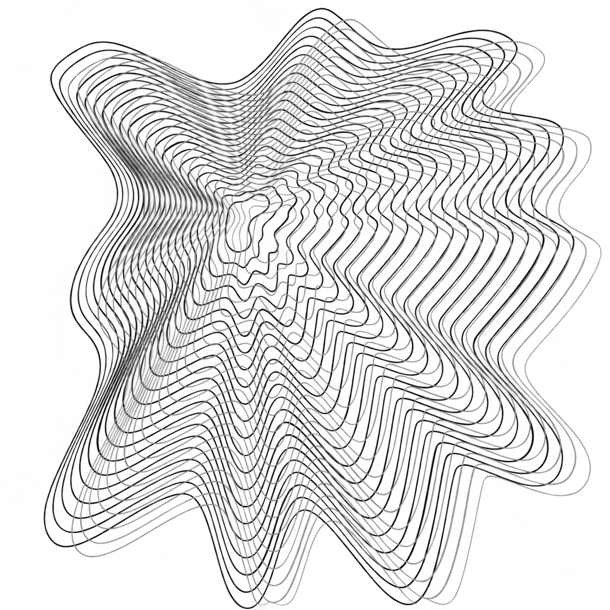

# PLASMATIO



A frameless Electron desktop interface based on the six supplied designs, with the Heptagon behavior system and installer-driven Windows updates.

## Get the project on your computer

The complete source and handoff documents are in this repository. Clone or pull the `main` branch; publishing a cloud environment does not push Git changes. Read `AGENTS.md` and `ChatgptFile.md` when continuing in a new coding session.

For Windows installation, open [the current installer](installers/PLASMATIO-Installer.exe) and use GitHub’s **Download raw file** action. See [installer notes and checksum](installers/README.md). Windows installation remains unverified.

## Run

```sh
npm ci
npm start
```

`npm run dev` serves the browser UI on port 5173. Native window buttons operate in Electron. The three visible additions are minimize, maximize/restore, and close; there is no window title bar. The empty upper-right strip beside the buttons can drag the window. Ctrl/Cmd+Q closes, Ctrl/Cmd+M minimizes, and F11 toggles fullscreen.

## Pages and navigation

The page directory is [`pages/`](pages/README.md). Welcome and Home preserve the original introductory screens. After entering a workspace, the app remembers the last workspace across launches. The far-left icon opens a vertical directory on hover, keyboard focus, or click: exactly four equal-sized symbols for Forge, Office, Arena, and Settings. The neighboring toolbar moves downward. Arrow keys move through the menu; Escape collapses it. Workspace navigation never sends the user back to the landing page.

All artwork and lettering come from the original screenshots. `layer-engine.js` recovers the original gradient and separates foreground regions into independently responding canvas elements. No replacement font, added content, or invented application panels are used. The welcome Google button changes the page only; account authentication, AI submission, project creation, and other backend functions have not been requested or implemented.

## Heptagon

Every registered visual element, including decorative art, labels, icons, background and window controls, has one visual behavior and one named synthesized sound for each of seven states:

| State | Trigger |
| --- | --- |
| Presence | Continuous subtle brightness cycle and quiet ambient tone |
| Proximity | Pointer approaches within 80 screen pixels |
| Hover | Pointer is over the element, or a control has keyboard focus |
| Click | The element receives a click |
| Other-click | Another element is clicked |
| Page leaving | Navigation away or application close |
| Page entering | The page is displayed |

Effects are defined centrally in `heptagon.js`. Identical simultaneous sounds share a voice so element counts do not multiply loudness. Reduced-motion preferences use opacity effects. A browser requires a gesture before playing sound; the desktop runtime starts it automatically. Close waits for the leaving animation, with a fallback if the renderer stops responding.

## Windows distribution

```sh
npm run release:windows
python3 scripts/windows-archive.py /path/to/PLASMATIO-Windows.zip
```

See [Windows build and update details](WINDOWS-BUILD.md). The release contains three visible items—Folder, Desktop App, Desktop Installer—and exactly three executable counterparts inside the hidden `.executables` directory. The transparent brand icon is assigned to the visible folder and shortcuts; executable icons remain unchanged. The icon is a transparent derivative of the supplied line artwork, included above for repository display.

Updates are installed by running the newest installer with the app closed. Each successful build replaces the previous generated release using stable filenames. The installer replaces the installed runtime and preserves user Folder contents. No automatic updater is included.

The Windows executables are cross-compiled and unsigned. Their structure and installer build are verified on Linux; Windows Explorer rendering and a real Windows installation/update still require Windows validation.

## Checks

```sh
npm run check
npm test
```

The Electron regression suite checks all seven states, sound bindings, all four workspace routes, menu geometry and toolbar displacement, and native window actions. Linux without a display uses Ozone headless; its synthetic 1×1 maximized display requires native restoration in that test. The app's normal display uses the operating system's window dimensions.
